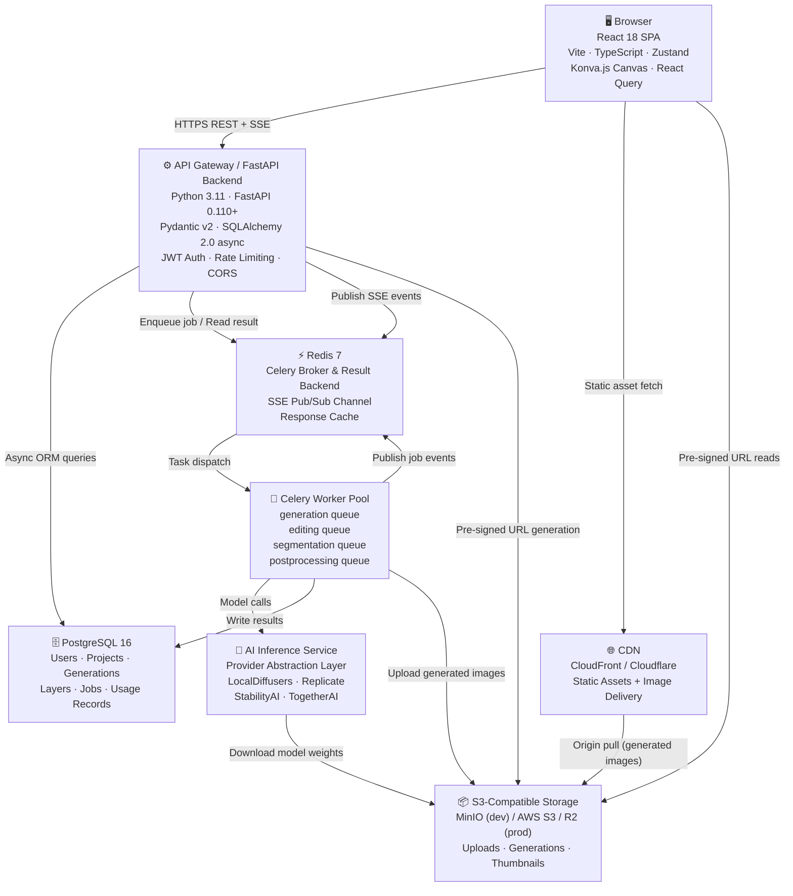
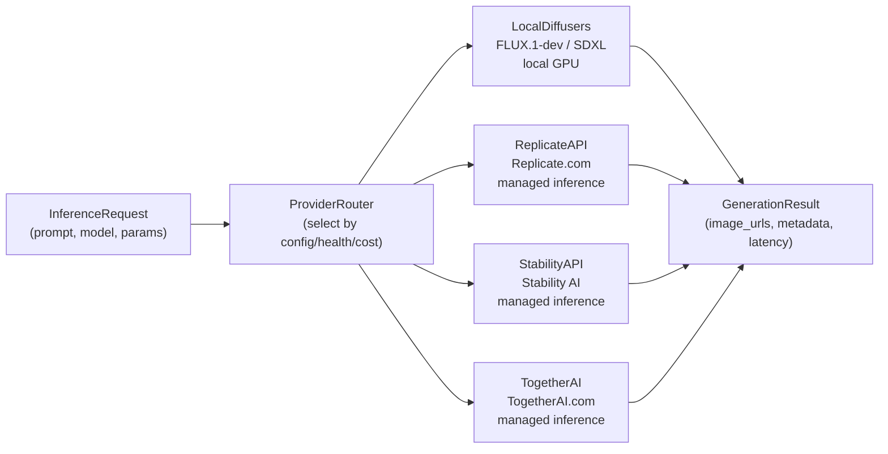
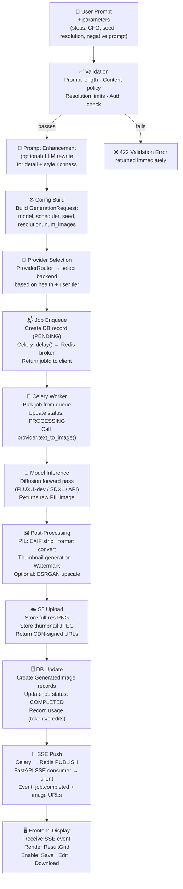
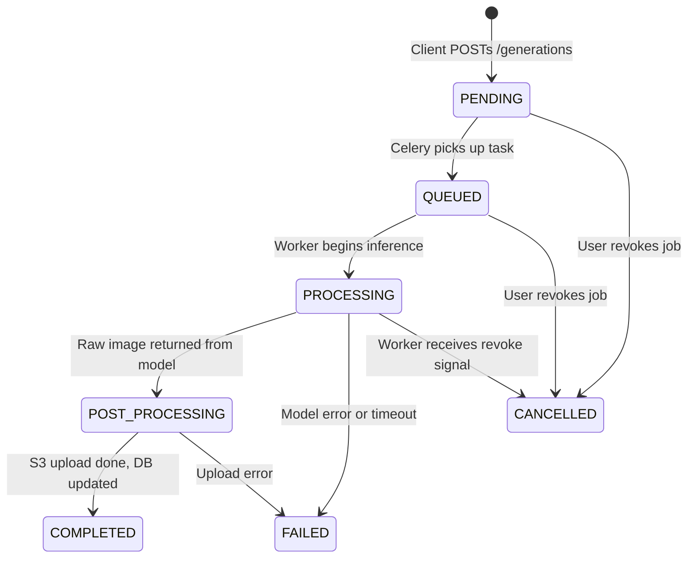
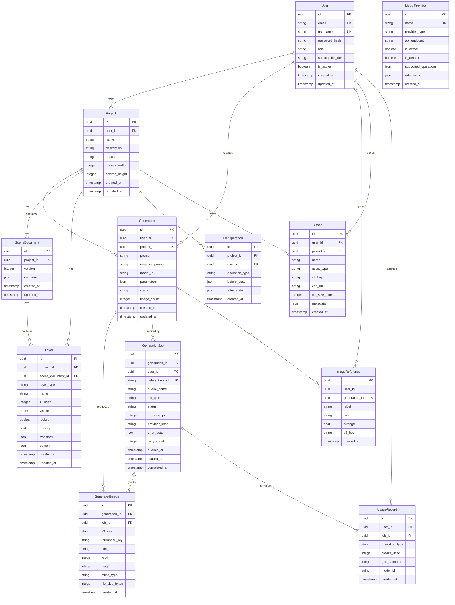
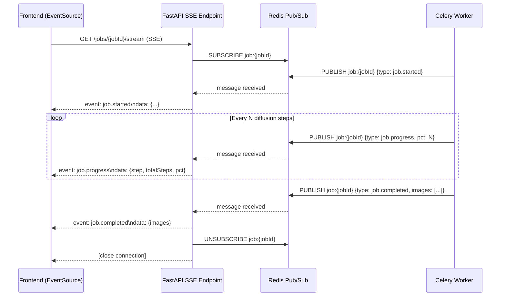

# SYSTEM ARCHITECTURE
## Reve-Inspired AI Image Generation & Visual Editing Platform

**Version:** 1.0  
**Status:** Authoritative Architecture Reference  
**Last Updated:** 2026-11-17

---

## Table of Contents

1. [High-Level Architecture Overview](#1-high-level-architecture-overview)
2. [Frontend Architecture](#2-frontend-architecture)
3. [Backend Architecture](#3-backend-architecture)
4. [AI Inference Architecture](#4-ai-inference-architecture)
5. [Pixel-Space Generation Pipeline](#5-pixel-space-generation-pipeline)
6. [Image Editing Pipeline](#6-image-editing-pipeline)
7. [Scene Graph / Layer Architecture](#7-scene-graph--layer-architecture)
8. [Database Architecture](#8-database-architecture)
9. [Storage Architecture](#9-storage-architecture)
10. [Job Queue Architecture](#10-job-queue-architecture)
11. [Real-Time Communication](#11-real-time-communication)
12. [Security Architecture](#12-security-architecture)

---

## 1. High-Level Architecture Overview

The platform is composed of seven discrete runtime tiers. Each tier has a single, well-defined responsibility. No tier reaches past its immediate neighbor; all cross-tier communication is mediated by documented interfaces.



### Tier Responsibilities Summary

| Tier | Technology | Responsibility |
|---|---|---|
| Browser SPA | React 18 + Vite | UI rendering, canvas editing, SSE client |
| CDN | CloudFront / Cloudflare | Static asset delivery, image edge caching |
| API Gateway | FastAPI + Uvicorn | REST API, auth, job dispatch, SSE streaming |
| PostgreSQL | PostgreSQL 16 | Authoritative relational state |
| Redis | Redis 7 | Celery broker/backend, pub/sub, response cache |
| Celery Workers | Celery 5 + Python | Async AI job processing, post-processing |
| AI Inference | diffusers / API SDKs | Model inference, provider abstraction |
| Object Storage | S3-compatible | Persistent binary asset storage |

---

## 2. Frontend Architecture

### 2.1 Feature-Based Folder Structure

```
src/
├── app/
│   ├── App.tsx                  # Root component, router outlet
│   ├── router.tsx               # React Router v6 route definitions
│   └── providers.tsx            # QueryClientProvider, ThemeProvider
│
├── features/
│   ├── auth/                    # Login, register, token refresh
│   │   ├── components/
│   │   ├── hooks/
│   │   └── authStore.ts         # Zustand store
│   │
│   ├── dashboard/               # Home, usage overview, quick-generate
│   │   └── components/
│   │
│   ├── generation/              # Text-to-image, img2img, variations
│   │   ├── components/          # PromptPanel, ParamsPanel, ResultGrid
│   │   ├── hooks/               # useGenerationJob, useSSEProgress
│   │   └── generationStore.ts   # Zustand store
│   │
│   ├── image-editor/            # Upload + raster editing workspace
│   │   ├── components/          # Toolbar, BrushTool, MaskOverlay
│   │   ├── hooks/
│   │   └── editorStore.ts
│   │
│   ├── canvas/                  # Konva.js canvas host + event bridge
│   │   ├── KonvaCanvas.tsx
│   │   ├── CanvasEventBridge.ts
│   │   └── canvasStore.ts       # Zustand store (stage config, zoom)
│   │
│   ├── layers/                  # Layer panel, layer operations
│   │   ├── LayerPanel.tsx
│   │   ├── LayerItem.tsx
│   │   └── layerStore.ts        # Zustand store (layer list, selection)
│   │
│   ├── references/              # Multi-reference image manager
│   │   ├── ReferenceManager.tsx
│   │   └── referenceStore.ts
│   │
│   ├── history/                 # Generation history browser
│   │   └── components/
│   │
│   └── projects/                # Project gallery, CRUD
│       ├── components/
│       └── projectStore.ts      # Zustand store
│
├── shared/
│   ├── api/                     # Axios instance, interceptors, typed endpoints
│   ├── components/              # Button, Modal, Toast, Spinner (design system)
│   ├── hooks/                   # useDebounce, useLocalStorage, useBreakpoint
│   ├── types/                   # Shared TypeScript interfaces
│   └── utils/                   # Canvas math, file helpers, formatters
│
└── assets/                      # Fonts, icons, static images
```

### 2.2 State Management — Zustand Stores

Each feature owns a Zustand store. Stores are intentionally narrow; cross-feature reads use selectors.

| Store | Owns | Key State Slices |
|---|---|---|
| `authStore` | Auth session | `user`, `accessToken`, `isAuthenticated`, `login()`, `logout()` |
| `generationStore` | Active generation job | `prompt`, `params`, `jobId`, `status`, `progress`, `resultImages` |
| `canvasStore` | Konva stage config | `stageRef`, `zoom`, `panOffset`, `selectedTool` |
| `layerStore` | Scene layer state | `layers[]`, `selectedLayerId`, `undoStack`, `redoStack` |
| `projectStore` | Project list + active | `projects[]`, `activeProjectId`, `sceneDocument` |

React Query (`@tanstack/query`) manages **server state** (projects list, generation history, asset library) with automatic caching, background refetch, and optimistic updates. Zustand manages **client-side ephemeral state** (canvas transforms, tool selection, in-progress job).

### 2.3 Canvas Layer System — Konva.js

The canvas workspace is built on `react-konva`. Each layer in the `SceneDocument` maps to a Konva `Node`:

- **Raster layer** → `Konva.Image` node loaded via `useImage` hook
- **Text layer** → `Konva.Text` node with live font attributes
- **Shape layer** → `Konva.Rect` / `Konva.Circle` / `Konva.Path`
- **Group layer** → `Konva.Group` containing child nodes

Transform handles (`Konva.Transformer`) provide drag/resize/rotate interactions. The layer `zIndex` maps to Konva's draw order. All transform mutations are dispatched through the command pattern and applied to `layerStore`, then persisted to the backend.

### 2.4 WebSocket / SSE Client

Job progress updates use **Server-Sent Events (SSE)** via the native `EventSource` API:

```typescript
// features/generation/hooks/useSSEProgress.ts
export function useSSEProgress(jobId: string) {
  useEffect(() => {
    if (!jobId) return;
    const es = new EventSource(`/api/v1/jobs/${jobId}/stream`, {
      withCredentials: true,
    });
    es.addEventListener("job.progress", (e) => {
      const data = JSON.parse(e.data);
      generationStore.getState().setProgress(data.progress);
    });
    es.addEventListener("job.completed", (e) => {
      const data = JSON.parse(e.data);
      generationStore.getState().setResult(data.images);
      es.close();
    });
    es.addEventListener("job.failed", () => {
      generationStore.getState().setFailed();
      es.close();
    });
    return () => es.close();
  }, [jobId]);
}
```

### 2.5 Routing — React Router v6

```
/                        → Dashboard
/generate                → Text-to-image generation workspace
/generate/:jobId         → Generation result view
/editor/:imageId         → Raster image editing workspace
/projects                → Project gallery
/projects/:projectId     → Project canvas (layer editor)
/history                 → Generation history browser
/settings                → Account, model, provider settings
/login                   → Auth
/register                → Auth
```

---

## 3. Backend Architecture

### 3.1 Layered Architecture

```
HTTP Request
     │
     ▼
┌─────────────┐
│   Router    │  FastAPI APIRouter — route registration, request parsing, response serialization
└──────┬──────┘
       │ calls
       ▼
┌─────────────┐
│   Service   │  Business logic — orchestration, validation, job dispatch, permission checks
└──────┬──────┘
       │ calls
       ▼
┌─────────────┐
│ Repository  │  Data access — SQLAlchemy async queries, no raw SQL outside this layer
└──────┬──────┘
       │ queries
       ▼
┌─────────────┐
│  Database   │  PostgreSQL 16 via asyncpg driver
└─────────────┘
```

### 3.2 FastAPI Application Structure

```
backend/
├── main.py                      # FastAPI app factory, lifespan, middleware
├── core/
│   ├── config.py                # Pydantic Settings (env-driven)
│   ├── security.py              # JWT encode/decode, password hashing
│   ├── database.py              # Async engine, session factory
│   ├── redis.py                 # Redis connection pool
│   └── celery_app.py            # Celery app instance + config
│
├── api/
│   ├── deps.py                  # Shared FastAPI dependencies (get_session, get_current_user)
│   └── v1/
│       ├── router.py            # Include all sub-routers
│       ├── auth.py              # /auth/register, /auth/login, /auth/refresh
│       ├── users.py             # /users/me
│       ├── projects.py          # /projects CRUD
│       ├── generations.py       # /generations — trigger + list
│       ├── jobs.py              # /jobs/{id} status + /jobs/{id}/stream SSE
│       ├── images.py            # /images — upload, metadata
│       ├── editing.py           # /editing — inpaint, outpaint, img2img
│       ├── layers.py            # /layers — scene document layer CRUD
│       └── assets.py            # /assets — asset library
│
├── services/
│   ├── generation_service.py
│   ├── editing_service.py
│   ├── project_service.py
│   ├── storage_service.py       # S3 pre-signed URL generation, upload
│   └── sse_service.py           # Redis pub/sub → SSE event stream
│
├── repositories/
│   ├── user_repo.py
│   ├── project_repo.py
│   ├── generation_repo.py
│   ├── job_repo.py
│   └── layer_repo.py
│
├── models/                      # SQLAlchemy ORM models
├── schemas/                     # Pydantic request/response schemas
└── tasks/                       # Celery task modules
    ├── generation_tasks.py
    ├── editing_tasks.py
    ├── segmentation_tasks.py
    └── postprocessing_tasks.py
```

### 3.3 SQLAlchemy Async Session Management

```python
# core/database.py
from sqlalchemy.ext.asyncio import create_async_engine, AsyncSession, async_sessionmaker

engine = create_async_engine(settings.DATABASE_URL, pool_size=20, max_overflow=10)
AsyncSessionLocal = async_sessionmaker(engine, expire_on_commit=False)

# api/deps.py
async def get_session() -> AsyncGenerator[AsyncSession, None]:
    async with AsyncSessionLocal() as session:
        try:
            yield session
            await session.commit()
        except Exception:
            await session.rollback()
            raise
```

### 3.4 Celery Task Routing

| Queue | Tasks | Workers |
|---|---|---|
| `generation` | `run_text_to_image`, `run_img2img` | GPU workers (high memory) |
| `editing` | `run_inpaint`, `run_outpaint` | GPU workers |
| `segmentation` | `run_object_segmentation` | GPU workers (lower priority) |
| `postprocessing` | `generate_thumbnail`, `apply_upscale` | CPU workers |

```python
# core/celery_app.py
app.conf.task_routes = {
    "tasks.generation_tasks.*": {"queue": "generation"},
    "tasks.editing_tasks.*":    {"queue": "editing"},
    "tasks.segmentation_tasks.*": {"queue": "segmentation"},
    "tasks.postprocessing_tasks.*": {"queue": "postprocessing"},
}
```

### 3.5 Background Job Lifecycle

```
PENDING → QUEUED → PROCESSING → POST_PROCESSING → COMPLETED
                                               ↘
                       FAILED ←── (any stage on error)
                       CANCELLED ←── (user revoke)
```

Each transition writes the new status to `generation_jobs.status` and publishes a Redis event for SSE delivery.

---

## 4. AI Inference Architecture

### 4.1 Provider Abstraction



### 4.2 BaseProvider Interface

```python
from abc import ABC, abstractmethod
from dataclasses import dataclass

@dataclass
class ProviderHealth:
    available: bool
    latency_ms: float
    queue_depth: int
    error_message: str | None = None

class BaseImageProvider(ABC):
    """Every inference backend implements this interface.
    The ProviderRouter calls these methods and is unaware of
    which concrete implementation it holds."""

    @abstractmethod
    async def text_to_image(self, request: GenerationRequest) -> GenerationResult: ...

    @abstractmethod
    async def image_to_image(self, request: Img2ImgRequest) -> GenerationResult: ...

    @abstractmethod
    async def inpaint(self, request: InpaintRequest) -> GenerationResult: ...

    @abstractmethod
    async def outpaint(self, request: OutpaintRequest) -> GenerationResult: ...

    @abstractmethod
    def health_check(self) -> ProviderHealth: ...
```

### 4.3 ProviderRouter Selection Logic

The `ProviderRouter` selects a backend at job dispatch time using:
1. **Explicit override**: user/admin specifies provider in request params
2. **Health filter**: providers with `available=False` are excluded
3. **Cost policy**: free-tier users route to local diffusers; paid users may access managed APIs
4. **Capability check**: not all providers support inpainting or ControlNet; router filters by task type
5. **Fallback chain**: if primary is unhealthy, cascade to next available

---

## 5. Pixel-Space Generation Pipeline

> **CRITICAL DESIGN NOTE:** Pixel-space generation produces raster images through actual AI model inference. This is a first-class, independent system. It is NOT replaced by scene-graph canvas rendering. Both systems coexist: generation creates raster assets; the layer canvas composes them. These are complementary, never conflated.

### 5.1 Full Pipeline Diagram



### 5.2 Job Status Transitions



### 5.3 Progress Event Stream

During generation, the Celery worker emits progress updates through Redis pub/sub at regular intervals:

| Event Type | When | Payload |
|---|---|---|
| `job.queued` | Task accepted by broker | `{jobId, position, estimatedWait}` |
| `job.started` | Worker begins inference | `{jobId, workerId, model}` |
| `job.progress` | Each diffusion step | `{jobId, step, totalSteps, pct}` |
| `job.completed` | Images ready | `{jobId, images: [{url, thumbnailUrl, width, height}]}` |
| `job.failed` | Error occurred | `{jobId, error, retryable}` |

---

## 6. Image Editing Pipeline

The editing pipeline handles raster image manipulation. It is distinct from generation but shares the same Celery/Redis/S3 infrastructure.

### 6.1 Upload → Edit Canvas

```
1. Client POSTs /images/upload (multipart, max 25MB)
2. Backend validates: MIME type ∈ {image/jpeg, image/png, image/webp},
   dimensions ≤ 8192×8192, file size ≤ 25MB
3. Backend stores original to S3: /users/{userId}/uploads/{imageId}_original.{ext}
4. Backend creates Image DB record (status=UPLOADED)
5. Backend returns {imageId, url, width, height, presignedUrl}
6. Frontend loads image into Konva canvas as a raster layer
7. User is now in the editing workspace
```

### 6.2 Inpainting Flow

```
1. User paints a mask using the brush tool (Konva overlay layer)
2. Frontend serializes mask as a PNG (Konva stage.toDataURL() on mask layer)
3. Client POSTs /editing/inpaint:
   {imageId, maskBase64, prompt, negativePrompt, strength, steps, cfg}
4. Backend creates GenerationJob (type=INPAINT, status=PENDING)
5. Celery editing queue: worker downloads original + mask from S3
6. Worker calls provider.inpaint(InpaintRequest)
7. Model returns inpainted PIL image
8. Post-processing: format, thumbnail
9. S3 upload: /users/{userId}/generations/{jobId}/result.png
10. DB update: job COMPLETED, GeneratedImage record created
11. Redis PUBLISH → SSE client → Frontend renders result
12. User may accept (replace layer) or reject (keep original)
```

### 6.3 Layer Operations

Each layer operation is a command dispatched through the command pattern:

```
User Action → Command Object → layerStore.dispatch(cmd)
                                       │
                      ┌────────────────┼────────────────┐
                      ▼                ▼                 ▼
               Apply to         Push to           Persist to
               Konva stage    undoStack         /layers API
```

**Supported operations:**
- `AddLayerCommand(layerConfig)` — Add raster, text, or shape layer
- `DeleteLayerCommand(layerId)` — Remove layer
- `MoveLayerCommand(layerId, x, y)` — Translate layer
- `ResizeLayerCommand(layerId, width, height)` — Scale layer
- `RotateLayerCommand(layerId, angle)` — Rotate layer
- `ReorderLayerCommand(layerId, newZIndex)` — Change z-order
- `SetOpacityCommand(layerId, opacity)` — Change opacity
- `SetVisibilityCommand(layerId, visible)` — Toggle visibility

### 6.4 Undo / Redo Stack (Command Pattern)

```typescript
// features/layers/layerStore.ts (Zustand slice)
interface LayerStoreState {
  layers: Layer[];
  undoStack: Command[];
  redoStack: Command[];
  dispatch(cmd: Command): void;
  undo(): void;
  redo(): void;
}

dispatch(cmd) {
  cmd.execute(draft.layers);       // mutate layer state
  draft.undoStack.push(cmd);       // record for undo
  draft.redoStack = [];            // clear redo on new action
  debouncedPersist(draft.layers);  // async save to backend
}
undo() {
  const cmd = draft.undoStack.pop();
  cmd.revert(draft.layers);
  draft.redoStack.push(cmd);
  debouncedPersist(draft.layers);
}
```

The undo stack is capped at 50 commands. Persist calls are debounced to 800ms to avoid flooding the API on rapid interactions.

---

## 7. Scene Graph / Layer Architecture

### 7.1 Design Principle

> **Raster images are valid, fully editable layers without requiring segmentation.** A generated image placed on the canvas is immediately available as a raster layer — it can be moved, scaled, rotated, masked, and composited without any additional AI processing.
>
> **Object-level editability** (selecting an individual object within a raster layer, isolating it, or replacing it independently) requires explicit AI-assisted segmentation. Segmentation is an opt-in enhancement, not a prerequisite for layer editing.

This keeps the editing experience fast and predictable while making powerful object-aware editing available on demand.

### 7.2 SceneDocument JSON Schema

The `SceneDocument` is the authoritative JSON representation of a project canvas. It is stored in the `scene_documents` table and serialized to/from the frontend layer state.

```json
{
  "id": "550e8400-e29b-41d4-a716-446655440000",
  "version": 1,
  "canvas": {
    "width": 1024,
    "height": 1024,
    "background": "#000000"
  },
  "layers": [
    {
      "id": "a1b2c3d4-e5f6-7890-abcd-ef1234567890",
      "type": "raster",
      "name": "Background",
      "visible": true,
      "locked": false,
      "opacity": 1.0,
      "zIndex": 0,
      "transform": {
        "x": 0,
        "y": 0,
        "width": 1024,
        "height": 1024,
        "rotation": 0,
        "scaleX": 1.0,
        "scaleY": 1.0
      },
      "content": {
        "imageUrl": "s3://reve-bucket/generations/job-id/result.png",
        "thumbnailUrl": "s3://reve-bucket/generations/job-id/thumb.jpg",
        "originalWidth": 1024,
        "originalHeight": 1024,
        "mimeType": "image/png"
      }
    },
    {
      "id": "b2c3d4e5-f6a7-8901-bcde-f12345678901",
      "type": "text",
      "name": "Headline",
      "visible": true,
      "locked": false,
      "opacity": 1.0,
      "zIndex": 1,
      "transform": {
        "x": 100,
        "y": 80,
        "width": 824,
        "height": 120,
        "rotation": 0,
        "scaleX": 1.0,
        "scaleY": 1.0
      },
      "content": {
        "text": "Sample Headline",
        "fontFamily": "Inter",
        "fontSize": 72,
        "fontWeight": "bold",
        "color": "#FFFFFF",
        "align": "center",
        "letterSpacing": -2
      }
    },
    {
      "id": "c3d4e5f6-a7b8-9012-cdef-123456789012",
      "type": "shape",
      "name": "Overlay Rect",
      "visible": true,
      "locked": false,
      "opacity": 0.4,
      "zIndex": 2,
      "transform": {
        "x": 0, "y": 820, "width": 1024, "height": 204,
        "rotation": 0, "scaleX": 1.0, "scaleY": 1.0
      },
      "content": {
        "shapeType": "rect",
        "fill": "#000000",
        "stroke": null,
        "strokeWidth": 0,
        "cornerRadius": 0
      }
    }
  ],
  "metadata": {
    "createdAt": "2026-11-17T04:00:00Z",
    "updatedAt": "2026-11-17T04:30:00Z",
    "thumbnail": "s3://reve-bucket/projects/project-id/thumb.jpg"
  }
}
```

### 7.3 Layer Type Registry

| `type` | Rendered as | Editable Properties | Requires AI? |
|---|---|---|---|
| `raster` | Konva.Image | transform, opacity, blend mode | No (placement); Yes (inpaint/segment) |
| `text` | Konva.Text | font, size, color, alignment | No |
| `shape` | Konva.Rect/Circle/Path | fill, stroke, corner radius | No |
| `group` | Konva.Group | child layers, group transform | No |

---

## 8. Database Architecture

### 8.1 Entity-Relationship Diagram



### 8.2 Key Indexes

```sql
-- Performance-critical indexes
CREATE INDEX idx_generation_job_status ON generation_jobs (status, queued_at);
CREATE INDEX idx_generation_user_created ON generations (user_id, created_at DESC);
CREATE INDEX idx_layer_project_zindex ON layers (project_id, z_index);
CREATE INDEX idx_usage_user_created ON usage_records (user_id, created_at DESC);
CREATE INDEX idx_asset_user_project ON assets (user_id, project_id);
```

---

## 9. Storage Architecture

### 9.1 S3 Bucket Structure

```
reve-storage/
├── users/
│   └── {userId}/
│       └── uploads/
│           ├── {imageId}_original.png       # Raw user upload
│           └── {imageId}_thumb.jpg          # Upload thumbnail
│
├── generations/
│   └── {jobId}/
│       ├── result_0.png                     # Full-resolution output(s)
│       ├── result_1.png
│       └── thumb_0.jpg                      # Thumbnail for gallery
│
├── projects/
│   └── {projectId}/
│       ├── scene_thumb.jpg                  # Canvas preview thumbnail
│       └── assets/
│           └── {assetId}.{ext}              # Project-scoped assets
│
├── references/
│   └── {userId}/
│       └── {referenceId}.{ext}             # Reference images for generation
│
└── models/
    └── {modelId}/
        └── weights/                         # Cached model weight files
```

### 9.2 Pre-Signed URL Strategy

All S3 objects are private. Clients never receive AWS/S3 credentials. Access is mediated through:

| Access Pattern | Mechanism | Expiry |
|---|---|---|
| View generated image | Pre-signed GET URL returned with job result | 24 hours |
| Upload user image | Pre-signed PUT URL issued by `/images/upload-url` | 15 minutes |
| Download full-resolution | Pre-signed GET URL issued on demand | 1 hour |
| CDN-cached thumbnails | Thumbnails served via CloudFront with signed cookies | 7 days |

```python
# services/storage_service.py
def generate_presigned_url(s3_key: str, expires_in: int = 3600) -> str:
    return s3_client.generate_presigned_url(
        "get_object",
        Params={"Bucket": settings.S3_BUCKET, "Key": s3_key},
        ExpiresIn=expires_in,
    )
```

### 9.3 Thumbnail Generation Pipeline

After every successful generation and upload, the `postprocessing` Celery queue triggers thumbnail generation:

```
Full-res PNG received by worker
         │
         ▼
PIL.Image.open()
         │
         ▼
thumbnail = image.copy()
thumbnail.thumbnail((512, 512), PIL.Image.LANCZOS)
         │
         ▼
Save as JPEG, quality=85, progressive=True
         │
         ▼
Upload to S3: /generations/{jobId}/thumb_N.jpg
         │
         ▼
Update GeneratedImage.thumbnail_key
```

---

## 10. Job Queue Architecture

### 10.1 Celery Configuration

```python
# core/celery_app.py
app = Celery("reve")
app.conf.update(
    broker_url=settings.REDIS_URL,
    result_backend=settings.REDIS_URL,
    task_serializer="json",
    result_serializer="json",
    accept_content=["json"],
    timezone="UTC",
    enable_utc=True,

    # Named queues
    task_queues=(
        Queue("generation",     routing_key="gen.#",    priority=5),
        Queue("editing",        routing_key="edit.#",   priority=5),
        Queue("segmentation",   routing_key="seg.#",    priority=3),
        Queue("postprocessing", routing_key="post.#",   priority=7),
    ),
    task_default_queue="generation",

    # Retry strategy
    task_acks_late=True,
    task_reject_on_worker_lost=True,

    # Dead letter queue via kombu
    task_queues_extended={
        "generation": {
            "x-dead-letter-exchange": "dead_letters",
            "x-dead-letter-routing-key": "dead.generation",
        }
    },
)
```

### 10.2 Priority Queuing

Workers are started with named queue bindings. GPU workers process `generation` and `editing` exclusively. Priority within each queue uses Celery's native `apply_async(priority=N)` (0=highest, 9=lowest):

| Job Type | Priority | Rationale |
|---|---|---|
| Free tier generation | 5 (normal) | Standard queue position |
| Paid tier generation | 2 (high) | Paid users jump queue |
| Inpainting | 4 (slightly elevated) | Interactive, user is waiting |
| Segmentation | 7 (low) | Background enrichment |
| Thumbnail | 8 (lowest) | Never user-blocking |

### 10.3 Retry Strategy

```python
@app.task(
    bind=True,
    max_retries=3,
    default_retry_delay=60,          # 1 minute base
    autoretry_for=(ProviderError,),
    retry_backoff=True,              # exponential: 60s, 120s, 240s
    retry_backoff_max=300,           # cap at 5 minutes
    retry_jitter=True,               # ±25% jitter to avoid thundering herd
)
def run_text_to_image(self, job_id: str, request_data: dict): ...
```

**Dead Letter Queue:** Tasks that exhaust all retries are routed to `dead_letters` exchange. A separate monitoring consumer reads DLQ messages, marks the DB job as `FAILED` with full error context, and publishes a `job.failed` SSE event.

### 10.4 Job Cancellation

```python
# api/v1/jobs.py
@router.delete("/{job_id}")
async def cancel_job(job_id: str, current_user: User = Depends(get_current_user)):
    job = await job_repo.get(job_id, user_id=current_user.id)
    if job.status in (JobStatus.PENDING, JobStatus.QUEUED):
        celery_app.control.revoke(job.celery_task_id, terminate=False)
    elif job.status == JobStatus.PROCESSING:
        celery_app.control.revoke(job.celery_task_id, terminate=True, signal="SIGTERM")
    await job_repo.update_status(job_id, JobStatus.CANCELLED)
    await redis.publish(f"job:{job_id}", json.dumps({"type": "job.cancelled"}))
```

---

## 11. Real-Time Communication

### 11.1 Architecture

The platform uses **Server-Sent Events (SSE)** for unidirectional job progress streaming. SSE is preferred over WebSockets because:
- Job updates are server → client only (no need for bidirectional)
- Native browser `EventSource` supports automatic reconnection
- SSE works through HTTP/2 multiplexing with no special proxy config
- Simpler than WebSocket handshake and frame management



### 11.2 SSE Endpoint Implementation

```python
# api/v1/jobs.py
@router.get("/{job_id}/stream")
async def stream_job_progress(
    job_id: str,
    current_user: User = Depends(get_current_user),
    redis: Redis = Depends(get_redis),
):
    async def event_generator():
        pubsub = redis.pubsub()
        await pubsub.subscribe(f"job:{job_id}")
        try:
            async for message in pubsub.listen():
                if message["type"] != "message":
                    continue
                data = json.loads(message["data"])
                yield f"event: {data['type']}\ndata: {json.dumps(data)}\n\n"
                if data["type"] in ("job.completed", "job.failed", "job.cancelled"):
                    break
        finally:
            await pubsub.unsubscribe(f"job:{job_id}")
            await pubsub.close()

    return StreamingResponse(
        event_generator(),
        media_type="text/event-stream",
        headers={
            "Cache-Control": "no-cache",
            "X-Accel-Buffering": "no",           # Disable nginx buffering
            "Connection": "keep-alive",
        },
    )
```

### 11.3 Event Type Catalog

| Event Type | Publisher | Consumer | Payload |
|---|---|---|---|
| `job.queued` | FastAPI (at dispatch) | Frontend generationStore | `{jobId, queuePosition, estimatedWaitSec}` |
| `job.started` | Celery worker | Frontend progress bar | `{jobId, workerId, model, provider}` |
| `job.progress` | Celery worker | Frontend progress bar | `{jobId, step, totalSteps, pct}` |
| `job.completed` | Celery worker | Frontend result display | `{jobId, images: [{url, thumbUrl, width, height}]}` |
| `job.failed` | Celery worker / DLQ consumer | Frontend error state | `{jobId, error, retryable, retryCount}` |
| `job.cancelled` | FastAPI (revoke endpoint) | Frontend cancelled state | `{jobId}` |

---

## 12. Security Architecture

### 12.1 Authentication — JWT + Refresh Token Pattern

```
Access Token:   JWT, RS256, TTL = 15 minutes
Refresh Token:  Opaque random string (256-bit), stored hashed in DB, TTL = 7 days

Flow:
  POST /auth/login  → returns {accessToken, refreshToken}
  All API calls     → Authorization: Bearer {accessToken}
  On 401            → POST /auth/refresh {refreshToken} → new {accessToken, refreshToken}
  POST /auth/logout → revoke refreshToken in DB
```

Access tokens are **never stored in localStorage**. They are stored in memory (Zustand `authStore`). Refresh tokens are stored in `HttpOnly`, `SameSite=Strict`, `Secure` cookies to prevent XSS access.

### 12.2 API Key Management for AI Providers

External AI provider API keys (Replicate, StabilityAI, TogetherAI) are:
- Stored encrypted in environment variables / secrets manager (AWS Secrets Manager / HashiCorp Vault)
- Loaded only into Celery worker processes at startup
- **Never** transmitted to the frontend or included in API responses
- Rotated without code deployments via secrets manager

### 12.3 File Upload Validation Pipeline

Every file upload passes through a multi-stage validation chain before storage:

```
1. Content-Type header check: must be image/jpeg | image/png | image/webp
2. File size limit: reject > 25MB before reading body
3. Magic bytes check: read first 16 bytes, verify file signature matches MIME
4. PIL.Image.open() + verify(): detects malformed or corrupt images
5. Dimension limits: width ≤ 8192, height ≤ 8192
6. python-magic deep scan: secondary MIME detection from content, not header
7. Strip EXIF metadata with piexif before storage (privacy)
8. Store to private S3 key; never serve from user-controlled path
```

### 12.4 Additional Security Controls

| Control | Implementation |
|---|---|
| Rate limiting | `slowapi` on FastAPI; 60 req/min per IP, 10 generation req/hour per free user |
| CORS | Explicit origin allowlist; no wildcard in production |
| SQL Injection | SQLAlchemy ORM only; no raw SQL outside indexed repository layer |
| SSRF | S3 key paths sanitized; no user-controlled URLs fetched server-side |
| Content Security Policy | Strict CSP headers on all HTML responses |
| Input sanitization | All text fields pass through bleach; prompts truncated to 2000 chars |
| Audit logging | All auth events and job submissions written to audit log table |

---

## Appendix: Technology Versions Reference

| Component | Technology | Version Target |
|---|---|---|
| Frontend framework | React | 18.3+ |
| Build tool | Vite | 5.x |
| Language (FE) | TypeScript | 5.x |
| Styling | Tailwind CSS | 3.x |
| Canvas | Konva.js / react-konva | 9.x |
| State (client) | Zustand | 4.x |
| State (server) | TanStack Query | 5.x |
| Backend framework | FastAPI | 0.110+ |
| Language (BE) | Python | 3.11+ |
| Validation | Pydantic | v2 |
| ORM | SQLAlchemy | 2.0 (async) |
| Migrations | Alembic | 1.13+ |
| Task queue | Celery | 5.x |
| Message broker | Redis | 7.x |
| Primary database | PostgreSQL | 16.x |
| Image processing | Pillow / Pillow-SIMD | 10.x |
| AI framework | HuggingFace diffusers | 0.27+ |
| Object storage | S3-compatible (MinIO / AWS / R2) | — |
| Auth | PyJWT + bcrypt | — |
| Containerization | Docker + Docker Compose | — |

---

*SYSTEM_ARCHITECTURE.md — Reve Platform — © 2026*
